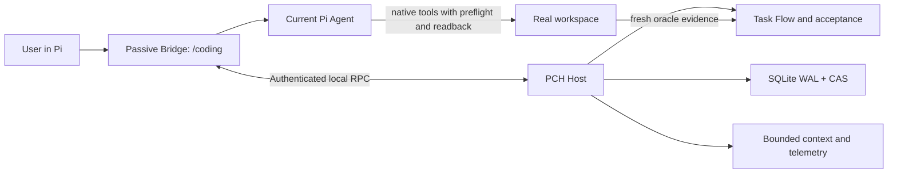

# PCH 1.3 architecture

This document explains the Single implementation. The normative contract is
[PI-CODING-HARNESS-BLUEPRINT.md](PI-CODING-HARNESS-BLUEPRINT.md); fresh evidence is in [VALIDATION.md](VALIDATION.md).

## Architecture promises

| Boundary | Behavior |
|---|---|
| Inactive | No Host, database, RPC, prompt addition or model request without explicit entry or a validated prior same-session binding |
| Small task | One direct WorkCell in the current Pi Agent; no role selection, Worker or extra model session |
| Authority | SQLite WAL, immutable receipts, CAS and lease/fencing checks own task state and effects |
| Completion | Fresh local evidence must satisfy the current frozen acceptance requirements |
| Recovery | Restore exact Goal identity and pending operations; never infer success from chat or rerun an unknown effect |

## System architecture



The Bridge registers `coding_flow`, `coding_clarify` and `coding_context`, enabling them only during a managed task.
It sends compact hook data to the Host. The Host owns validation and authority; the current Pi Agent owns all
provider requests. Config is loaded lazily in the Host. An explicit Bridge data-root override wins; otherwise
`config.data.root` supplies storage, including a non-system drive.

## Task Flow model

```text
User source -> proposed Goal Contract -> USER review -> frozen contract
  -> near-term route -> authorized WorkCell -> native tool operation
  -> fresh evidence -> WorkCell completion -> Goal delivery
```

Acceptance facets refer to exact user source and obligations. Typed Goal Fit findings share the normal proposal
turn; they do not create a critic call. Only a user decision can freeze the Goal Contract. Plan additionally asks
Build/Keep/Revise before target writes. Material user changes are captured before any new mutation and invalidate
only dependent authority/evidence; unchanged evidence requires a matching reuse closure.

Pi prepares the system prompt once per user input. A transition that changes the phase or advances a WorkCell
therefore returns its current guide in the existing tool result, including automatic advancement after validation.
Unchanged guides are omitted. This uses no extra status RPC or provider request and does not expand command notices.

`DIRECT_CELL` keeps a small change direct. `ADAPTIVE_ROUTE` expands only the near-term WorkCells and records distant
outcomes as deferred. Repeated failures cause local repair, route correction, user clarification or reconciliation.
No-progress governance refuses repeated unchanged routes instead of growing an endless tool/model loop.

## Single execution

The Host checks the current ControlFrame, scope, lease and exact preimage before dispatch. Prepare and dispatch are
atomic. Native Pi tools execute the effect; the Host reads back each target and records the observed outcome before
commit. File content hashes are cached against filesystem metadata but revalidated across mutation boundaries.
Lease renewal is threshold-based. A successful managed write can become fresh exact-source context without an
extra Agent read.

Each frozen oracle command runs after the final write. Managed validation records evidence once. The last WorkCell
stays open for preservation review; a later write invalidates stale validation. Explicit completion or the existing
local Agent-settled hook closes only a ready WorkCell. No extra provider request is needed for this transition.

## Retired Multi execution

The menu, delegation tool, Worker RPCs, executor, mirror and scheduler are removed. Single does not construct a DAG,
collect Multi-comparability rollouts or sum Worker usage at every status update. The old implementation is in Git
history, not behind a runtime flag.

Existing schema-35 Worker/graph/provider/integration records keep their immutable codecs and integrity checks.
Recovery checks requested and effective topology before taking a lease and rejects unfinished Multi Goals. It does
not activate the old executor or reinterpret a pending-admission Goal as Single. The old three Worker config keys
are discarded before constructing the effective config. See [upgrade guidance](USER-GUIDE.md#upgrading-from-12).

## Durable authority and recovery

Migrations 001-035 remain ordered and hash-checked. Immutable events/receipts and CAS are authoritative; Markdown,
Pi JSONL markers and Widget state are projections. Session markers only identify a candidate Goal. The Host checks
the exact current binding, workspace and runtime-instance lease before attaching it.

Single restart rebuilds projections, reconciles unknown operations and validates the compaction frontier before
new writes. A live controller cannot be replaced by an unexpired competitor. A terminal Goal cannot resume work.
Historical Multi data is preserved without gaining new execution authority.

## Context and efficiency Modules

| Module | Purpose and fallback |
|---|---|
| Input Context | Current authority plus bounded evidence; exact deferred context is fetched only when needed |
| Memory | Encrypted optional local memory with explicit lifecycle, guarded capture and validity checks |
| Compaction | Pi-native compaction bracketed by durable before/after frontier checks |
| Cache | Non-mutating C1 only for matching verified contracts; other runtimes use C0 |
| Output | Widget for routine progress; concise final evidence; no rewrite model request |
| Accounting | Ordered background attempt settlement; unknown usage and unknown prices stay unknown |

Fewer tools and removed deterministic work lower particular overheads. They do not establish end-to-end token,
time or financial savings across workloads. The same model, task and correctness standard are needed for a cost
comparison. Scope snapshots are still refreshed where effect or acceptance correctness requires it.

## Source Module map

| Owner | Location |
|---|---|
| Public entry and native Pi hooks | `src/index.ts`, `src/bridge/register.ts` |
| Authenticated Host and protocol registry | `src/harness/host` |
| Task orchestration and operations | `src/runtime/task-flow-session.ts`, `src/task-flow` |
| Authority and artifacts | `src/authority`, `src/artifacts`, `schemas/sql` |
| Source-bound intake, plans and acceptance | `src/intake-v2`, `src/plan-v2`, `src/acceptance-v2` |
| Optional context features | `src/input-context`, `src/memory`, `src/context`, `src/cache-v2` |
| Historical execution/provider codecs | `src/harness/execution-v2`, `src/provider-v2`, `src/harness-v2` |
| Build and lifecycle | `scripts/build-runtime.mjs`, `scripts/*lifecycle*`, `src/runtime/lifecycle.ts` |

## Security model

Authenticated IPC rejects replay and malformed payloads. CAS content is hash-checked. Local paths, exact scope,
leases, fencing and observed preimages guard effects. Untrusted model text cannot attest itself, approve a contract,
grant a new topology or override pending-effect reconciliation. External or irreversible actions need the current
explicit user decision required by their authority contract.

The Host receives runtime identity, not Pi credentials. Runtime data, local configs containing credentials and test
reports remain outside source control. Installed builds remove obsolete generated files and refuse to clean a
linked output directory.

## Current repository evidence

See [VALIDATION.md](VALIDATION.md) and [PROJECT-STATUS.md](../PROJECT-STATUS.md). Historical benchmark results are
not rerun or relabeled to qualify a different scope. Multi benchmarks are outside 1.3; provider-specific cache,
natural long-context compaction and comparative cost claims keep their explicit limits.
